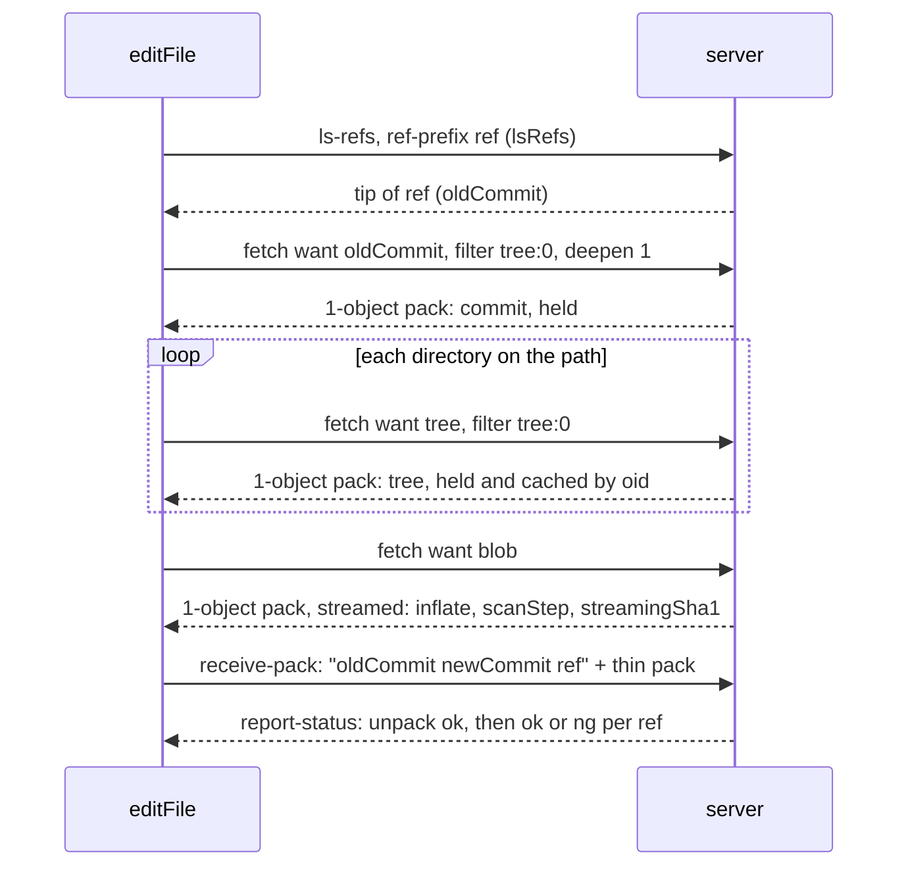

# Architecture

How ply is put together, for a contributor: the layers, one read and one edit traced from the public call to the wire
and back, where bytes are streamed and where they are held, which limit bounds each held thing, and the tradeoffs the
repository records. It points to the documents that own the details instead of repeating them:

- [SAFETY.md](../SAFETY.md): the invariants (I1, I2, …), each with the test that enforces it.
- [CONTEXT.md](../CONTEXT.md) §5 "Decisions and why": each decision with its measurement. Its §2 module map and §7
  numbers are dated 2026-10-20 (issue #301 tracks them).
- [docs/STACK.md](STACK.md): rules for code in `src/` (errors are values, pure steps with I/O at the edges, bounds
  before allocation, absence).
- [README.md](../README.md): the public API, limits, timers, telemetry.
- [docs/EVIDENCE.md](EVIDENCE.md): the claims-to-evidence index (#322). The native-git benchmark is
  [bench/compare](../bench/compare/README.md) (#323) and the recovery example is
  [examples/recover-push.mjs](../examples/recover-push.mjs) (#324).

History (campaigns, run logs, one-off experiments) is in [process/](../process/README.md) and CONTEXT.md §4, not here.
Names below are `src/` modules and the symbols they define; "internal" marks a function the module does not export.

## Layers

Each layer calls only the ones below it. `test/import-graph.test.js` asserts that `src/` has no value-import cycle;
`test/bundle.test.js` asserts what each package entry's bundle carries (for example, the read bundle carries no push,
merge or pack-building code). Neither test checks the layer order itself.

| Layer | Modules | What lives there |
|---|---|---|
| Entries and operations | `edit.ts` (`editFile`), `read.ts` (`readFile`, `listTree`, `openBlob`), `tree.ts`, `checkout.ts`, `log.ts`, `changes.ts`, `merge.ts`, `rebase.ts`, `refops.ts`, `transfer.ts`, `client.ts` (`GitHttp`); Node only: `tree-node.ts`, `checkout-node.ts`, `repo-node.ts` | what the caller calls |
| Operation frame | `operation.ts` (`operation`, `verifyRef`) | root span, transport, outcome, the after-push `ambiguous` rule |
| Commands | `lsrefs.ts` (`lsRefs`), `fetch.ts` (`objectAt`, `fetchObject`, `packStream`), `fetchpack.ts`, `negotiate.ts`, `pathtrees.ts`, `commit.ts`, `push.ts` (`push`), `discover.ts`, `receivecaps.ts` | one protocol exchange each, as free functions over a transport |
| Transport | `transport.ts` (the `Transport` record), `http.ts` (`createTransport`), `deadline.ts` (`exchangeClock`), `packcache.ts` (`cachingFetch`) | `t.frames(service, body, span, hints)` and `t.advertise(service, span)`; HTTP is the one implementation |
| Pure steps | `pktline.ts` (`pktStep`), `fetch.ts` (`v2Step`, `sidebandStep`, `spStep`, `spFinish`), `lsrefs.ts` (`lsRefsStep`), `push.ts` (`streamStep`, `classifyReport`, `decideOutcome`), `edit.ts` (`scanStep`, `decideHead`) | `(state, input) → Result<state>`; the pkt-line, v2, single-object pack and find/replace steps are chunking-invariant (SAFETY I10) |
| Codecs | `inflatestream.ts` (`inflatePull`), `packstream.ts`, `packresolve.ts` (`resolvePack`), `packwrite.ts`, `deltaenc.ts` (`spliceDelta`), `objects.ts`, `commit-build.ts`, `sha1.ts`, `validate.ts` | bytes in, values out |
| Shared | `errors.ts` (codes and `RETRY`), `limits.ts` (`parseLimits`, `DEFAULT_LIMITS`), `result.ts`, `absent.ts`, `format.ts`, `streambound.ts` (`peakBound`), `otel.ts` | |

Every call enters through `operation()`: it parses `limits` once (`parseLimits`), builds the transport
(`createTransport`, or the caller's through `transportFrom`), opens the root span, and turns anything a caller's
callback throws into a `Result` (README "`operation()`: your body's outcomes"). Below it errors are values; what may
still raise is a stream (it errors), `assertNever` and an `internal` invariant (docs/STACK.md "Public API policy").

## A read: `readFile(url, { ref, path })`

1. **Validate.** `read.ts` `readFile` checks the path (`pathComps` → `validate.ts` `validatePath`, bounded by
   `maxPathDepth`, `maxPathComponent`) and calls `operation('read', …)`.
2. **Ref → commit id.** `resolveCommit` → `lookupRef` (internal) → `lsrefs.ts` `lsRefs` with the ref's candidate
   prefixes. A 40-hex ref skips this step. Request: `pktline.ts` `pkts`. Response: frames from `t.frames`, folded by
   `lsRefsStep` into a `Map` of the listed refs (bounded by `maxRefs`, `maxLsRefsBytes`).
3. **Transport.** `http.ts` `transportOf` (internal) `frames()` POSTs to `<base>/git-upload-pack` with
   `Git-Protocol: version=2`. Its `post` generator (internal) reads the body through `deadline.ts` `readAbortable`
   and yields one network chunk at a time; `frames()` runs each chunk through `pktStep`, which copies each payload
   out of the chunk and carries at most one partial pkt-line (`PKT_MAX_SIZE`).
4. **Commit.** `pathtrees.ts` `commitForWalk` → `commit.ts` `commitById` → `fetch.ts` `objectAt` with
   `filter tree:0`, `deepen 1` where the server takes `deepen`. Where the server is known to take
   `combine:blob:none+tree:K`, `commitForWalk` asks for the commit and its first two tree levels in one fetch (the
   first time, beside the plain commit fetch) and harvests the trees (#218, SAFETY I42).
5. **Protocol framing.** `fetchRequest` / `fetchRequestBody` build the command; `packStream` drives `v2Step` over the
   frames: section lines (capped by `maxSectionLines`), then `sidebandStep`, which yields band 1 (pack bytes) and
   holds band 1 and band 2 each to `maxPackBytes` before a frame is passed on. Band 3 and `ERR` are `remote_error`.
   `v2End` judges the end of the answer.
6. **One object, inflated as it arrives.** `fetchSingle` (internal): `spStep` reads the 1-object pack header (the
   declared size refused past `maxObjectSize` before any buffer exists), passes the zlib bytes on (refused past
   `zlibBound(size)`) and keeps the 20-byte trailer back; `memberFeed` (internal) inflates them with
   `inflatestream.ts` (`inflateInit`, `inflatePull`) into one `Uint8Array` of the declared size. `spFinish` checks
   the pack trailer, then `singleObject` (internal) hashes the object (`objects.ts` `hashObject`, pure-JS SHA-1) and
   requires the want's id, then `assertFetched` parses it under the caller's limits (`maxTreeEntries` for a tree).
7. **Trees.** `walkFrom` (internal) fetches one tree per directory on the path (`objectAt`, `filter tree:0`),
   unless the caller's `cache` (a `Map` from oid to tree bytes) or the transport's harvest (`t.objects`) has it.
8. **Blob, streamed.** `openBlob` asks for the blob with no filter. Its pump pulls `packStream`, steps `spStep`, and
   writes the zlib bytes into the runtime's `DecompressionStream('deflate')`. Inflated chunks pass a
   `TransformStream` that counts them against the declared size, feeds `sha1.ts` `streamingSha1` (Workers' native
   `DigestStream`, else the pure-JS `Sha1`), and holds back the latest chunk. Its `flush` releases that chunk only
   after `spFinish` (pack trailer), the size check and the blob hash all pass; any failure errors the stream with the
   chunk still held. `readFile` returns `{ size, stream }` with `size` from the object header.

```
response body (runtime chunks)
 └► readAbortable              one network chunk at a time
 └► pktStep                    frames copied out of the chunk; carry ≤ one pkt-line (PKT_MAX_SIZE)
 └► v2Step / sidebandStep      band 1 passed on; band 1 and band 2 each ≤ maxPackBytes
 └► spStep                     pack and object header; zlib ≤ zlibBound(size); 20-byte trailer withheld
 └► DecompressionStream        the runtime's
     ├► readFile: size check, streamingSha1, latest chunk held ─► the caller's ReadableStream
     └► editFile: scanStep (carry ≤ |find| − 1) ─► streamingSha1 of the new blob; nothing kept
```

**Held during a read:** the ref listing (`maxRefs`, `maxLsRefsBytes`); the commit and every tree on the path, each
whole (`maxObjectSize`, `maxTreeEntries`), the trees also kept in `cache`; harvested commits and trees from a wide pack
(`maxHarvestBytes`, per transport); one network chunk and its frames; the inflate state (window plus one chunk); the
latest blob chunk. **Streamed:** the blob, at the caller's pace.

### When the server will not filter

`objectAt` learns from the server's answer, never from a host name. A 400 naming the filter (Cloudflare Artifacts)
sets `t.quirks.treeFilter = 'blob:none'`; an empty answer to a filtered request sends `filterUnadvertised` to the
advertisement, and no `filter` there sets `'none'`. Later fetches are then "wide": `wideFetch` (internal) reads the
pack through `packresolve.ts` `packCollectOpen` as it arrives, drops whole blobs the want cannot need, resolves deltas
with `resolvePack` (bounded by `maxPackObjects`, `maxInflatedTotal` with `LIMIT_OBJECT_OVERHEAD` per object,
`maxDeltaChain`, `maxDeltaResult`), checks the extras (`checkWide`) and harvests commits and trees into `t.objects`.
`probing` lets one request per quirks record learn while concurrent ones wait. SAFETY I30; README "Hosts that refuse
`filter tree:0`".

## An edit and push: `editFile(url, { ref, path, find, replace, … })`



1. **Plan.** `edit.ts` `editFile` parses `limits` (`limitsOf`) and the spec (`validateSpec`: ref, path, author,
   message, a non-empty `find`), then runs `editOnce` (internal) inside `operation('edit', …)`.
2. **Parent.** `lsRefs([ref])`. With a `head` hint, a speculative `objectAt` of that commit runs beside it;
   `decideHead` makes ls-refs win and reports the hint as `used` or `stale`. `strictHead` turns a stale hint into
   `cas_conflict` before anything is fetched further.
3. **Commit and trees.** `objectAt` as in the read's steps 5–7 (no `combine` filter), one tree per directory, each
   kept in `levels` and in `cache`; `findEntry` (internal) picks the next entry.
4. **Blob, streamed through the edit.** `streamBlobEdit` (internal): a pump like `openBlob`'s into
   `DecompressionStream`. The inflate side refuses a Git LFS pointer by its first bytes (`isLfsPointerPrefix`), then
   for each chunk runs `scanStep` (find/replace, carrying at most `|find| − 1` bytes) and feeds the transformed bytes
   to `streamingSha1`. The new blob's header is hashed first: the exactly-one-match contract fixes its length as
   `size − |find| + |replace|` before the content is seen. After the stream: inflated bytes must equal the declared
   size and the match count must be exactly one (`match_count` otherwise). `deltaenc.ts` `spliceDelta` writes the new
   blob as copy, insert, copy against the old blob from the match offset alone. Neither blob is ever held.
5. **Noop.** A new blob id equal to the old one returns `{ noop: true }` and pushes nothing.
6. **Objects.** `commit-build.ts` `buildCommitObjects`: for each tree from the leaf up, `objects.ts` `treeReplaceOid`
   writes the new tree, `hashObject` names it, and `spliceDelta` makes a 20-byte-replacement delta against the old
   tree; `encodeCommitOf` writes the commit on `oldCommit`. The pack list is the commit whole, each tree as a
   `REF_DELTA` on its old tree, and the blob as a `REF_DELTA` on the old blob (a blob delta shorter than git's
   `DELTA_SIZE_MIN`, 4 bytes, is sent as a whole object: SAFETY I9). An optional signer rewrites the commit
   (`sign.ts` `signCommit`).
7. **Pack.** `push.ts` `push` → `planPush` (refs, oids, bases, `maxRefs`) → `send` (internal). `oncePerObject`
   (internal) drops duplicate objects; `packwrite.ts` `measurePack` deflates each object through `CompressionStream`
   in `DEFLATE_SLICE` slices, keeping only lengths, entries and the SHA-1. A pack over `maxPackBytes` is
   `limit_exceeded` before any request. A pack of at most `INFLATE_CHUNK` bytes (an edit's usually is) is kept and
   sent as bytes; a larger one is deflated again by `streamPack` as the request body is read, and gets its trailer only
   if the second pass matches the first (SAFETY I41).
8. **receive-pack.** `pushBody` writes `<old> <new> <ref>` with `report-status`, `side-band-64k` and `agent`, a flush,
   then the pack; `editFile`'s `old` is `oldCommit`, or the zero id when creating the ref. The POST goes straight to
   `git-receive-pack`; the receive-pack advertisement is read only under `followRedirects: 'initial'` or to confirm a
   401/403/404 (below).
9. **Report.** `readResponse` (internal) folds frames through `streamStep` (sideband demultiplexing) and classifies
   lines as they arrive (`reportStep`), stopping at the first line that cannot be git's. It keeps one line per command
   (reason cut at `maxReportReasonBytes`, never below git's own longest reason), at most `maxReportLines` lines (never
   fewer than an honest report needs) and the band-2 tail; it reads at most `maxPackBytes` of answer and keeps at most
   `maxReportProgressBytes` of band 2. `decideOutcome` maps the shape to `landed`, `rejected` (`ngClass` per reason:
   `cas_conflict`, `not_fast_forward`, `push_rejected`, `limit_exceeded`), `partial` or `ambiguous`; `outcomeResult`
   turns it into the `Result`.
10. **Verify (opt-in).** `verify: true` reads the ref back with `operation.ts` `verifyRef`; anything but the new
    commit is `ambiguous` (SAFETY I25).

**Held during an edit:** the commit, every tree on the path (old bytes, new bytes, and the 20-byte-replacement
delta), `find`, `replace`, the scanner's carry, one inflate chunk, the built objects (small: one commit, path-many
tree deltas, one blob delta of about `|replace|` bytes), and the pack when it is at most `INFLATE_CHUNK`.
**Streamed:** the old blob, and the pack's second pass when it is larger.

## Backpressure, cancellation, deadlines

- **Pull, not push.** Response chunks are read only when the consumer asks: `readAbortable`'s chunks and `post` are
  generators, `frames()` and `packStream` are generators over them, and the blob stream is a `ReadableStream` with
  `highWaterMark: 0`. The pump into `DecompressionStream` awaits each write, so a reader that stops reading stops the
  pump and the transport, and the rest of the body stays unread in the runtime.
- **Cancel.** Cancelling `readFile`'s stream ends the spans, cancels the inflate side and returns the pack iterator;
  leaving `readAbortable` early cancels the response body. A push pack larger than `INFLATE_CHUNK` is a request body
  `ReadableStream` with `highWaterMark: 0`, read by the runtime as it sends (`watchedUpload`, in pieces of at most
  64 KiB).
- **AbortSignal.** `opts.signal` reaches every exchange: `exchangeClock` combines it with its own timer
  (`AbortSignal.any`), the signal goes to `fetch`, and `readAbortable` ends the body read on abort even when a
  wrapper does not. `wrapNet` makes it `aborted` or `timeout`. A push whose signal fired before the request is a
  definite `aborted`; once the request was handed over it is `ambiguous`.
- **Deadlines.** `deadline.ts` `exchangeClock` is a pure state machine (`transition`, `deadlineOf`) with one timer:
  `firstByteTimeoutMs` to the headers, `idleTimeoutMs` with no network progress, `heldTimeoutMs` while the consumer
  has taken a chunk and not asked for the next (a reader that stops long enough to stall the pump has the exchange
  cut as `timeout`, `what: 'heldTimeoutMs'`), and the opt-in `requestTimeoutMs`. There is no total cap by default
  (README "Limits", SAFETY I1).

## How memory scales

`streambound.ts` `peakBound` states the stream bounds; `test/stream-memory.test.js` measures them for the pull
codecs, `fetchSingle`, wide fetches and `fetchPack` (not for the `DecompressionStream` blob paths, whose buffers are
the runtime's).

| Grows with | Read (`readFile`) | Edit (`editFile`) | Bounded by |
|---|---|---|---|
| File size | constant: one inflate chunk, one held chunk | constant: one inflate chunk, scanner carry | wire: `maxPackBytes`, `zlibBound`; no `maxObjectSize` on the streamed blob |
| `find` / `replace` | — | held whole; the blob delta is about the size of `replace` | the caller's input; the pack by `maxPackBytes` |
| Tree size | each path tree held whole | each path tree held twice plus a delta | `maxObjectSize`, `maxTreeEntries` |
| Path depth | one tree per level, all kept | same, plus one new tree per level | `maxPathDepth` |
| Object count | one per narrow fetch (a commit want may also bring its tag); wide packs: every kept object | same | `maxPackObjects`, `maxInflatedTotal` (+ `LIMIT_OBJECT_OVERHEAD` each), `maxHarvestBytes` |
| Delta chain depth | none on the narrow path (`spStep` refuses a delta); wide packs resolve | edit writes depth-1 deltas only | `maxDeltaChain`, `maxDeltaResult`, `maxInflatedTotal` |
| Ref count | the listed refs | the listed refs | `maxRefs`, `maxLsRefsBytes` |
| Retained across calls | `cache` (caller's, unbounded by ply); the quirks memo when no `quirks` is passed (`QUIRKS_MEMO_MAX` remotes, per process or isolate); `t.objects` (`maxHarvestBytes`) | same | as listed |

## Compare-and-swap and `ambiguous`

The command line `<old> <new> <ref>` is the compare-and-swap: receive-pack moves the ref only if it is at `<old>`. A
lost race comes back as `ng <ref> <reason>`; `ngClass` classifies the reasons git and hosts write (SAFETY I31) and
`rejectionCode` makes it `cas_conflict` (`RETRY.cas_conflict` is `fresh`: re-resolve the parent, then retry).
`editFile` redoes attempt 0's `cas_conflict` once from a fresh ls-refs with no hint, linking the spans, unless
`strictHead` or `retry: false`. receive-pack unpacks before checking `<old>`, so a lost race leaves unreferenced
objects on the server; the ref update itself is atomic (README "Things the oracle taught us").

Once a push request is handed to the transport, ply reports landed or not landed only on a report exactly as git
writes it; everything else is `ambiguous` (`RETRY.ambiguous` is `read`: read the ref back before retrying), via
`errors.ts` `ambiguousAfterPush`. That covers network failure, HTTP status, framing, band 3, a malformed or cut
report, a limit hit while reading the report, a second deflate pass that refused, a caller callback that threw after
the hand-over (`operation`), and a failed `verifyRef`. Exceptions, each definite: a 401/403/404 before any frame of the
answer that the receive-pack advertisement repeats (`refusedBeforeReceivePack`); a streamed body the transport never
pulled; and a single-ref push answered with an empty band 3 (Cloudflare Artifacts under a race), which
`resolveAmbiguousByTip` (internal) settles by reading the ref (`landed`, or `cas_conflict`). SAFETY I2, I11, I36;
the push outcome space is enumerated in [SPACE.md](../SPACE.md).

## Who is responsible for what

| Party | Owns |
|---|---|
| Caller | the URL, credential and `limits`; consuming or cancelling the stream; `signal` or `requestTimeoutMs` for a wall-clock bound; the tree `cache` and `quirks` record it passes and their size; what to do with `ambiguous` (read back) and `cas_conflict` (retry fresh); returning expected outcomes from an `operation()` body as values |
| ply | parsing and bounding every wire-driven size before allocating; hashing every object and the pack trailer; never releasing unverified blob bytes; the ref command's `<old>`; classifying the report; refusing a pack over `maxPackBytes` before sending; keeping credentials out of spans and errors (SAFETY I6) |
| Server | the atomic ref update and its `<old>` check; enforcing its own push and fetch caps; filter support (learned, not assumed) |
| Runtime | `fetch`, TLS, redirects (ply sends `redirect: 'manual'` or `'error'`), socket and upload buffering below `fetch`, `DecompressionStream` and `CompressionStream`, `DigestStream` where present, timers |

## Tradeoffs the repository records

| Choice | Instead of | Code | Evidence | Record |
|---|---|---|---|---|
| Transport is a record with two methods; HTTP is the only one | a class hierarchy, per-transport branches | `transport.ts` `Transport`, `http.ts` `createTransport` | `test/custom-exchange.test.js`, `test/bundle.test.js` | CONTEXT §5 |
| Stream the blob, verify before releasing the last chunk | buffer, hash, then return | `read.ts` `openBlob`, `edit.ts` `scanStep` | `test/read.test.js` (lying server), `test/edges.test.js` (24 MB blob) | SAFETY I3, I7 |
| `maxPackBytes` checked once in `v2Step`; `zlibBound` per object in `spStep` | a cap in every consumer | `fetch.ts` `sidebandStep`, `spStep` | `test/adversarial.test.js`, `test/fuzz/hostile.mjs` | CONTEXT §5 |
| Inflate fetched objects and packs as they arrive (#172) | join the pack, then parse | `fetch.ts` `collectWire`, `streambound.ts` | `test/stream-memory.test.js` | README "Memory" |
| Deflate the push pack twice and stream pass 2 (#172) | hold the pack (about 4× the largest object) | `packwrite.ts` `measurePack`, `streamPack` | `test/packwrite.test.js`, `test/push-stream.test.js` | CONTEXT §5, SAFETY I41 |
| Learn filter support from the answer; fall back to `blob:none` or no filter | detect by host, or fail | `fetch.ts` `objectAt`, `transport.ts` `probing` | `test/wide-limits.test.js`, `test/no-filter.test.js`, `test/artifacts-compat.test.js` | CONTEXT §5, SAFETY I30 |
| First two path levels ride with the commit where the server takes `combine` | one round trip per level | `pathtrees.ts` `commitForWalk` | `test/path-trees.test.js` | CONTEXT §5, SAFETY I42 |
| Cache wants-only fetch answers; the client's own parse checks a HIT | trust or re-verify in the cache | `packcache.ts` `cachingFetch` | `test/packcache.test.js` | CONTEXT §5, SAFETY I14 |
| `head` hint overlaps ls-refs; ls-refs always wins | skip ls-refs | `edit.ts` `decideHead` | `test/packcache.test.js`, `test/workerd.test.js` | SAFETY I15 |
| Per-exchange first-byte, idle and held timers; no total cap | one request timer (cut long healthy streams) | `deadline.ts` `exchangeClock` | `test/deadline.test.js`, `test/deadline-scenarios.test.js`, `test/upload-progress-socket.test.js` | CONTEXT §5, SAFETY I1 |
| Redirects not followed by default | follow (credential to another origin) | `http.ts` `redirectPolicy` | `test/redirect.test.js` | CONTEXT §5 |
| Pure-JS sync `hashObject`; native `DigestStream` for streams | `crypto.subtle.digest` (async, whole buffer) | `sha1.ts` `Sha1`, `streamingSha1` | `test/sha1.test.js` | CONTEXT §5 (#214) |
| Report-or-`ambiguous` allowlist after the push is handed over | trust the transport's error code | `push.ts` `decideOutcome`, `operation.ts` `operation` | `test/space/push-outcome.test.js`, `test/adversarial.test.js`, `test/operation-callback-contract.test.js` | SAFETY I36 |
| Errors are values (`Result`), closed `Code` union | throw | `result.ts`, `errors.ts` | `scripts/throw-ratchet.mjs` | docs/STACK.md |

## Limitations

- Protocol v2 for fetch and v0 receive-pack for push, over HTTP(S) only; SHA-1 repositories only (`unsupported`
  otherwise). No SSH transport.
- The streamed blob is bounded on the wire by `maxPackBytes` (128 MiB by default), not unbounded.
- The streamed blob paths use the runtime's `DecompressionStream`; its internal buffering and chunk size are the
  runtime's, and no test measures their heap. The edit's `mem.alloc.*` span attributes are counted from the scanner's
  state, not measured from the heap.
- Trees on the path are held whole, so one very large directory costs up to `maxObjectSize`; `maxTreeEntries` refuses
  past it.
- `find` and `replace` are held whole and are not limited by `limits`.
- The tree `cache` a caller passes grows with every new tree ply adds to it; ply does not evict.
- After the push is handed over, `ambiguous` is an outcome ply cannot resolve except in the one empty-band-3 case:
  the caller reads the ref back. A lost race leaves unreferenced objects on the server.
- What SAFETY.md "Explicitly not proven here" lists (for example GitHub push, SHA-256) applies here too.
